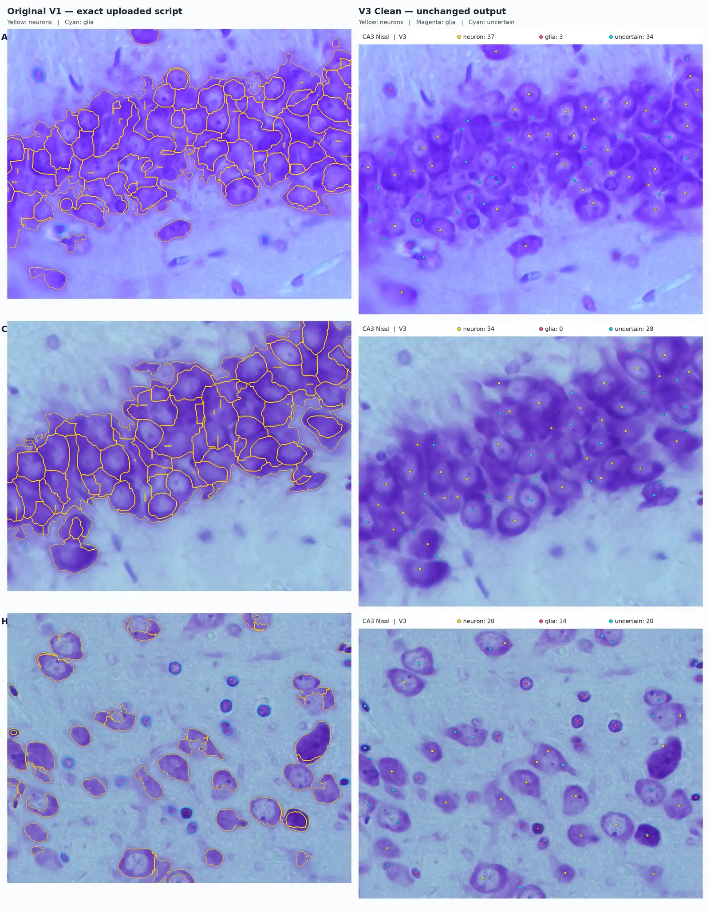

# CA3 Nissl Image Analysis

A Python proof-of-concept for analyzing cresyl-violet (Nissl)-stained hippocampal CA3 sections. This repository preserves two approaches to identifying stained cell profiles and their centres.



*Rows: images A, C and H. Left: V1 segmentation boundaries (yellow: neuron-like; cyan: glia-like). Right: V3 cell-centre markers (yellow: neuron-like; pink: glia-like; cyan: uncertain). Labels are heuristic, not independently verified cell identities.*

## Methods

| | V1 — `nissl_pipeline.py` | V3 Clean — `ca3_nissl_v3_clean.py` |
|---|---|---|
| Core approach | Optical density → Otsu threshold → morphological cleanup → seeded watershed | Same segmentation foundation, followed by nuclear-cue-based centre recentering |
| Output | Original and boundary overlay, counts, mean neuronal area, estimated neuropil fraction | One annotated PNG per image and a concise `summary.csv` |
| Cell labels | Neuron-like / glia-like | Neuron-like / glia-like / uncertain |

In V1, candidate nuclei and distance-transform peaks seed watershed regions. V3 shifts eligible region centres toward a local nuclear-contrast peak and flags certain small or irregular profiles as *uncertain*. V3 does **not** add an independently trained classifier or guarantee improved cell-type identification.

## Quick start

Install Python and dependencies:

```bash
python -m pip install -r requirements.txt
```

V1 saves `<image>_overlay.png` and prints quantitative measurements. V3 saves `<image>_V3.png` and a run-level `summary.csv` containing `image`, `neurons`, `glia`, `uncertain` and `total`. Use `--export-points` with V3 to additionally save per-centre coordinates.

## Interpretation and limitations

- **Exploratory morphology-based estimates:** cresyl-violet appearance alone is insufficient for unequivocal identification of neurons versus glial subtypes. The *uncertain* class is a review flag, not a distinct biological cell class.
- **Segmentation is stain- and architecture-sensitive:** touching somata, weakly stained profiles and non-cellular structures can introduce false positives or false negatives.
- **Not unbiased stereology:** 2D object counts and pixel fractions do not estimate absolute neuron number without appropriate sampling, section-thickness and counting-frame methods.


## Files

- `nissl_pipeline.py` — original V1 watershed-based segmentation
- `ca3_nissl_v3_clean.py` — clean V3 centre-recentering workflow
- `figures/V1_vs_V3_A_C_H.webp` — comparison across three CA3 image fields
- `requirements.txt` — Python dependencies
